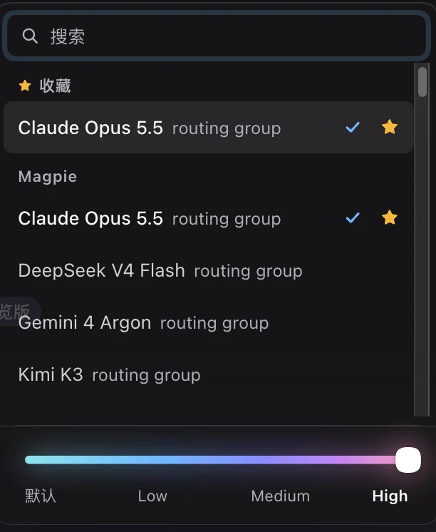

# dsh-iridescent-model-selector

[English](README.md) | 中文

DeepSeek Harness（`dsh`）客户端插件：用自己的选择器替换输入框里的模型按钮。按钮上直接显示当前模型和思考档位，点开后在一个面板里完成选模型、管理收藏和调整思考程度。



## 功能

- **直接选模型**：面板列出 harness 模型目录里的全部模型，按服务商分组。可用模型超过 4 个时显示搜索框。点一行即切换当前会话下一次请求所用的模型。
- **收藏**：悬停在某一行，点星标即可把模型固定到列表顶部的「收藏」分组。最多 24 个，保存在浏览器本地存储里。
- **思考程度滑杆**：当前模型声明了几个档位，滑杆就有几个刻度。一条连续的极光渐变（青 → 蓝 → 紫 → 玫瑰）随档位升高逐渐展开，光晕和流光也随之增强。松开滑块或点击档位名称即生效。
- **按模型记住档位**：每个服务商和模型的组合会记住上次使用的思考程度，切回该模型时自动恢复（前提是模型仍提供这个档位）。
- **原生备用**：插件以更高优先级占用输入框的模型位，不删除内置选择器。内置选择器仍在下面保持注册，停用或卸载本插件后会重新显示。`/model` 命令不受影响。
- 支持键盘操作（↑/↓ 选模型，在搜索框按 Enter 选中第一个结果，Esc 关闭）、中文输入法、中英文界面，以及系统的「减少动态效果」设置。

## 兼容性

在 **DeepSeek Harness Desktop 0.2.1-rc.3** 上测试，`engines.dsh` 锁定为该版本。

插件读取内置插件 `@deepseek-ai/dsh-client-ui-model-selection` 提供的会话模型目录（`modelDirectories`）。这是 harness 的内部实现，后续版本可能变化。请保持内置模型选择插件处于启用状态，否则本插件不会生效。

## 安装

Web（`dsh web`）：

```sh
dsh plugin --profile web add git+https://github.com/JackieJam/dsh-iridescent-model-selector.git
```

桌面端：在应用的插件管理器里用同一个 Git 地址安装；本插件被插件市场（如 dsh-market）收录后也可以在市场里一键安装。

想恢复内置选择器，停用或卸载本插件即可。

## 说明

- 模型和档位的切换走 harness 自己的会话模型选择流程；已经在运行的步骤保持它开始时的模型和档位。
- 收藏和记住的档位保存在 DSH 页面的 `localStorage` 中，只在本机生效，不会同步。

## 许可证

[MIT](LICENSE)
